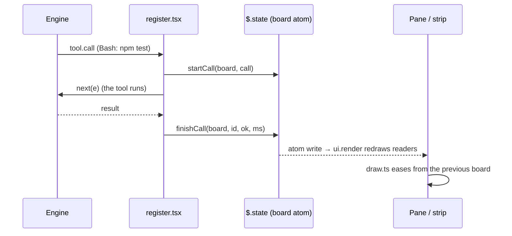

# Architecture

Embermeter is one Claude Code hooks module, split into three layers so the parts that matter can be tested without the engine.

```
hooks/register.tsx   engine wiring      the only code that touches `$`
        │  Board (immutable value)
        ▼
hooks/core.ts        state + analytics  pure functions, no I/O
        │  Board + Cfg
        ▼
hooks/draw.ts        design system      pure SVG strings
```

## Data flow



1. **Events in.** `register.tsx` listens to `prompt.submit`, `turn.start`, `turn.complete`, `tool.check`, `tool.call`, `agent.spawn`, `session.measure` and `session.compact`. Each handler maps the event to one `core.ts` transition (`startCall`, `endTurn`, `spawnAgent`…) and writes the new board to the `board` atom.
2. **Sensors.** One `$.clock.every` timer. Sensors (`/sys`, `/proc`) are sampled every 5 seconds. The clock ticks every second only while a turn or a subagent is running. The context breakdown (`session.usage({ breakdown: 'summary' })`, a local estimate) is refreshed at most every 15 seconds, and always after a turn or a compaction.
3. **Render.** `ui.render` hooks for `Pane` and `AbovePrompt` read the atom, so any write redraws them. `register.tsx` keeps the previously drawn board for each site, and `draw.ts` uses it to ease values from the old reading to the new one.

## State

`types/index.d.ts` declares the contract: `PluginState.embermeter = { board, tab }`. The board is a plain, immutable value. Every transition returns a new board.

Lists are capped, so a long session stays flat in memory:

| List | Cap |
|---|---|
| calls | 60 |
| log | 60 |
| context history | 60 |
| activity buckets (per minute) | 60 |
| thermal history | 90 |
| turns | 40 |
| agents | 40 |
| durations per tool (for p95) | 50 |
| models | one entry per model used |
| days in the lifetime store | 60 |

`normalize()` fills in any field missing from a board stored by an older version. That way, after an upgrade, a hot reload or a resumed session never crashes on an old shape.

Lifetime totals (`sessions`, `turns`, `calls`, `usd`) and the same four totals per local calendar day (the last 60 days) are the only values kept across sessions, in `$.store`.

## Analytics

| Signal | How it's computed |
|---|---|
| **Runway** | Average context growth of the last 6 turns that grew, then `(ceiling − now) / burn`. The ceiling is the auto-compact threshold when it's on, otherwise 100%. |
| **Health** | Starts at 100. Loses points for context above 60% (up to 30), tool errors above 5% (up to 25), temperature near or over the limit (10 or 20), denials (up to 10), a rate limit over 80% (15), going over budget (10), and a loop (15). Grades: A ≥ 90, B ≥ 75, C ≥ 60, D ≥ 45, otherwise F. |
| **Cost rate** | Session cost divided by elapsed hours, and the average cost of the turns that have one. |
| **Cache hit** | `cacheRead / (input + cacheRead + cacheWrite)`. |
| **Throughput** | Output tokens divided by turn time, over the last 8 turns. |
| **p95** | 95th percentile of the last 50 durations of each tool. |
| **Budget runway** | `(budget − cost) / average cost per turn`, rounded down. |
| **Loop watch** | The same call (tool and input) three times back to back, or the same call failing three times in the last 12 calls. Subagent calls and calls without an input are left out, and so is Read from the back-to-back rule, because paging through one large file repeats the path. |
| **Context fed by tools** | The text each tool's result handed the model, at about four characters per token. An estimate: good for ranking tools, not for billing. |
| **Model split** | Each finished turn adds its cost, input (fresh + cache) and output tokens to the model that answered it. |
| **Alerts** | Each threshold fires once. The context alerts re-arm after a compaction. Budget alerts fire at 50%, 80% and 100%. Each distinct loop alerts once. |

## Heat guard

A second `tool.call` hook, matched on `Bash` only:

1. If `guard` is off or the command doesn't match `heavyPattern`, the call passes.
2. `refuse(vitals, cfg)` checks the **last cached** sensor reading. The guard never reads the disk on the tool path.
3. If the CPU is over `maxTempC`, or the battery is discharging below `minBatteryPct`, the call is denied with a message that tells Claude to wait or ask the user.

Temperature comes from CPU sensors first (`x86_pkg_temp`, `TCPU`, `coretemp`, `k10temp`, `cpu-thermal`). It falls back to the hottest zone only when none of those exist, because ACPI and Wi-Fi zones often report trip points rather than die temperature. The default heavy pattern matches whole command words, never parts of paths or flags.

## Rendering

- **Surfaces.** VS Code and the desktop app draw SVG (`Svg` element, image mode). The terminal gets the same data as `Text`. Hover doesn't run in image mode, so every value is printed, not hidden behind a tooltip.
- **Motion** is SMIL only, with no script: `ease()` animates from the previous value with an ease-out-quint spline. Loops (particles, pulses, breathing) are emitted only while their stage is active, and only with `motion: smooth`.
- **Layout.** `drawContext(cfg, prev, columns)` picks a 640 px canvas at 76 columns or more, otherwise 400 px. Every page lays itself out for both widths.
- **Safety.** `txt()` is the only place text enters SVG, and it escapes `& < > "`.

## Testing

- `tests/core.test.ts` covers every analytic and transition in `core.ts`.
- `tests/draw.test.ts` draws the Spend, Tools and Context pages at both widths and checks that user text arrives escaped.
- `tests/pane.test.tsx` mounts the real module on the `vscode`, `desktop` and `terminal` surfaces against a stub engine, then drives a tool call through it.
- `scripts/render-docs.ts` renders every page from a fixed sample session. CI runs it as a smoke test, and contributors use it to refresh the README images.
